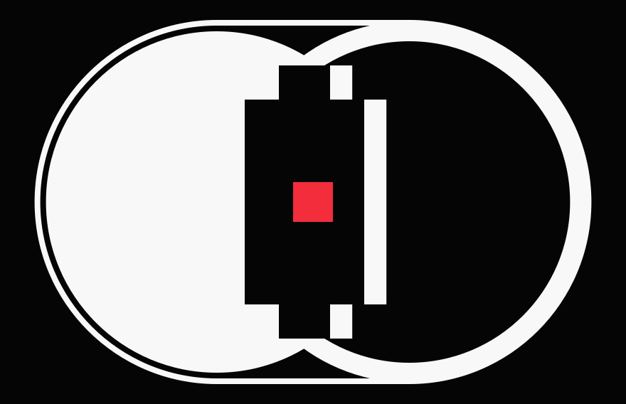
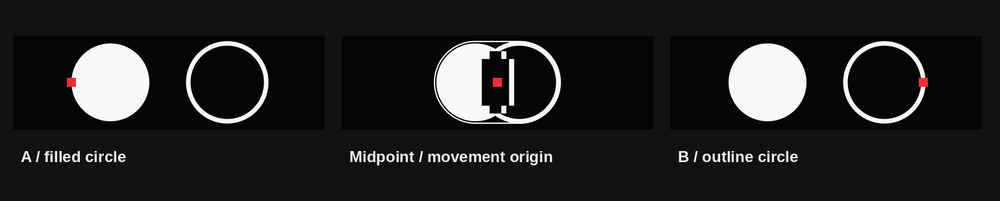
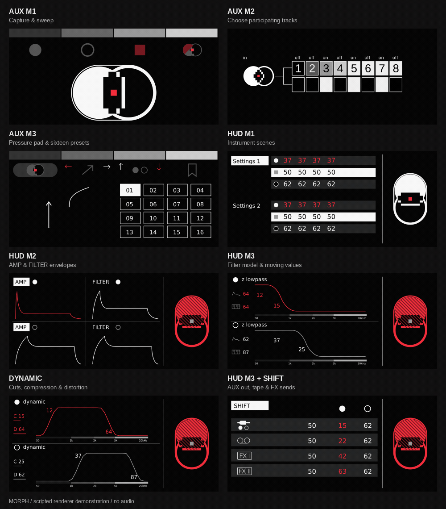
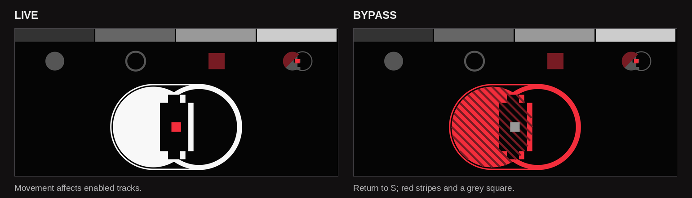

<div align="center">
  
  <h1>Morph for OP-XY</h1>
  <p><strong>Two scenes. Eight tracks. One performance.</strong></p>
  <p>Capture sounds, choose the tracks that follow, and move towards either scene.</p>
  <p>
    <a href="docs/Morph-Quick-Reference.pdf">Illustrated guide</a> ·
    <a href="docs/INSTALLATION.md">Installation</a> ·
    <a href="docs/AI_INSTALLATION_SUPPORT.md">AI support</a> ·
    <a href="docs/VALIDATION.md">Validation</a>
  </p>
</div>

Morph is a custom OP-XY machine that captures **A and B scenes across all eight instrument tracks**. Each scene holds supported instrument, envelope, filter and send settings. Perform changes with an encoder, the onboard pressure pad, MIDI or the stock LFO, while choosing which tracks participate.

AUX is Morph's home for capture, routing, pad settings and presets. Hold a selected instrument track to open its **Morph HUD**, where you can inspect and edit the captured scenes beside the sound controls.

**Source version:** `1.3.1-dev-gui2d2` · **Firmware baseline:** stock OS `1.2.1` with the supplied SDK integration.

## Read the circles

| Symbol | Meaning |
| --- | --- |
| **Filled circle — A** | The first captured scene; left in AUX, above in the HUD. |
| **Outline circle — B** | The second captured scene; right in AUX, below in the HUD. |
| **Small moving square** | Your position in the sweep. |
| **Outer capsule** | Appears at the exact midpoint only. |
| **S** | A separate stored return snapshot. BYPASS returns participating tracks to S. |



**The midpoint is the movement origin, not necessarily S.** The square used for the SET S command is a button symbol; the moving square in the sweep indicates position.

## Eight views of Morph



This 12-second loop uses the actual gui2d2 display renderer with scripted example inputs and a substitute preview font. Each tile demonstrates its own controls; it is not a recording of eight simultaneous device screens. The loop has no audio. [View the static collage](docs/images/morph-eight-screens.png).

### AUX: capture, route and perform

- **M1 — capture & sweep.** Capture A and B, set the return snapshot S, move towards either scene, and switch LIVE/BYPASS.
- **M2 — track routing.** Include or exclude each instrument track. Capture still includes all eight tracks; routing controls which ones Morph changes.
- **M3 — pad & presets.** Choose pitch bend or Morph pad control, adjust sensitivity, select SQRT/LINEAR/EXP response, and save or load sixteen A/B presets.
- **M4 — stock LFO.** Modulate Morph's movement control using the normal LFO interface. LIVE must be enabled.

### Instrument HUD: edit the scenes

Hold the selected instrument track for **150 ms** to open the HUD. Release to close, or use the latch gesture described in the guide.

- **M1:** supported instrument parameters in A/S/B rows.
- **M2:** AMP and FILTER envelopes, with A above B. Red identifies the selected scene/envelope; the white title marks the selected bank.
- **M3:** the current filter model and its A/B graphical controls. Dynamic uses K1 low cut, K2 compression, K3 distortion and K4 high cut.
- **SHIFT:** current/A/B values beside stock parameter icons. Unsupported scene fields show dashes.

The stock scramble/copy/paste/save menu hides after **1.5 seconds** of eligible track hold, while its actions remain available. Hold the track **before** SHIFT for Morph gestures; SHIFT before track preserves stock menu access.

## Make your first morph

**K1–K4** are the encoders above the screen. **M1–M4** are the module buttons below it.

1. Open Morph on AUX, normally AUX 4 / CV, and select M1.
2. Prepare a sound, then press **K1** to capture A across all eight tracks.
3. Change the sound, then press **K2** to capture B.
4. On AUX M2, choose which tracks should follow the performance.
5. Return to M1 and turn **K4** to sweep. Press K4 to enter BYPASS and return participating tracks to S.

Press **K3** on AUX M1 to explicitly set S. S follows stored instrument settings in BYPASS and stays frozen in LIVE except for explicit SET S.



## Movement, recording and presets

| Feature | How it works |
| --- | --- |
| **Encoder** | AUX M1 K4 sweeps. In the HUD, hold K4 while turning to sweep. |
| **Pressure pad** | AUX M3 K1 toggles pad mode; K2 turns change speed and K2 presses cycle the curve. Down/left moves towards A, up/right towards B. Release holds position. Enable LIVE first. |
| **MIDI** | Receive channel 12, CC15: `0` = A, `63/64` = movement origin, `127` = B. Enable LIVE first. |
| **Recording** | While playing, hold RECORD and turn AUX M1 K4. Only this physical AUX encoder movement is recorded as Morph automation. |
| **Erase automation** | Hold BAR, then press M2 on Morph AUX. This clears all parameter locks in that AUX pattern, retaining notes and other tracks. |
| **A/B presets** | On AUX M3, turn K3 or K4 to select 01–16. Press K3 to load; press K4 to save/replace immediately. Both require BYPASS; playback may continue. Presets exclude S. |
| **Project persistence** | Keep the `.xy` project and its `.oxy` companion together. The companion stores Morph snapshots, pad settings and the recording origin. |

Manual BYPASS stays bypassed when the LFO or recorded movement continues. Excluded tracks stay at their current sound, including when returning to S. See the [illustrated guide](docs/Morph-Quick-Reference.pdf) for source takeover, captures, SHIFT chords, preset compatibility and the full gesture reference.

## Install or update

This repository provides source and an exact-base SDK addition. **It does not include a flashable firmware image, private kit, compiler toolchain or the signed macOS Manager app.**

### With an existing Manager

1. Preserve the working installation and its build/backup records. Select the correct XY profile and scan its installed setup.
2. **Already using the gui2d SDK edition?** Keep it. Successful gui2d1/gui2d2 installations use the same addition; do not import it again.
3. **Using the matching earlier GUI SDK?** Import [the SDK addition](integration/Morph_gui2d_SDK_Addition.zip). Its importer checks the exact base and creates a separate installer. Investigate any mismatch instead of forcing it.
4. In the prepared Manager, import [the current Morph source ZIP](release/Morph_gui2d2_Source.zip) and select **Replace installed Morph**. Do not add a second Morph or replace unrelated machines.
5. Follow the normal calculate/build/review/stage/readback workflow and the established manual **WRITE OS** procedure. File staging and readback do not themselves write the boot partition.

**New computer, different OS or a different SDK edition?** Start with [Installation](docs/INSTALLATION.md). For guided troubleshooting, give your assistant [AI installation support](docs/AI_INSTALLATION_SUPPORT.md).

### Platform compatibility

This table describes the **pinned SDK snapshot in this repository**, not a promise about newer upstream versions.

| Host | Native build support in this snapshot |
| --- | --- |
| Apple-silicon macOS | Authenticated `darwin-arm64` toolchain profile; the owner's established Manager workflow. |
| Windows x86_64 | Authenticated `windows-x86_64` profile. Source Manager/MTP workflow was not validated end-to-end here. |
| Linux x86_64 | Authenticated `linux-x86_64` profile. Build the pinned tools using the documented Docker recipe; glibc 2.36+ is required. |
| Other architectures | No matching native profile is documented here. Do not substitute another host's toolchain. |

Each XY needs its **own profile and installed-setup scan**. Keep firmware, private kits, build jobs and device backups outside the Git checkout.

## Status and limits

The owner reported **no regression and features working** on gui2d1; gui2d2 corrects the dynamic-filter mapping and AUX sensitivity artwork. Detailed native CPU/memory measurements and a comprehensive gui2d2 device checklist are not included.

Repository assembly passes authenticated SDK preparation, the **18,350-check** original installer boundary suite and focused GUI, geometry, control-isolation and compositor checks. The full SDK suite has documented baseline-matching failures; these have not been reclassified as a pass.

- Filter graphics are control-position visualizations, not calibrated DSP measurements. Dynamic C/D bars show parameter amounts, not live audio levels.
- Minor envelope streaks at zero attack or maximum release were accepted by the owner and intentionally left unchanged.
- Firmware compatibility depends on the exact SDK integration and installed setup, not only the version label.

See [Validation](docs/VALIDATION.md) and [repository check results](REPOSITORY_CHECKS.txt) for the evidence and remaining limits.

## Develop and contribute

From the repository root, with Python 3.11+ and GNU g++ with UBSan:

```sh
python3 tools/prepare_sdk.py
python3 tools/check.py
```

Preparation verifies the original installer payload, creates a separate `local/prepared-installer`, and runs its original boundary checks. It does not access the XY. On Windows, use the selected Python 3.11+ interpreter, for example `py -3.12`, instead of `python3`.

After changing source or the guide, rebuild the import ZIP:

```sh
python3 tools/package_source.py
```

Read [Development](docs/DEVELOPMENT.md), [Architecture](docs/ARCHITECTURE.md) and [AGENTS.md](AGENTS.md) before changing the integration. Keep graphics, control behaviour and SDK changes separately reviewable. A passing host test does not replace a Blackfin build or device test.

For a useful bug report, include the source version, host OS/architecture, active SDK edition, the affected page (**AUX M3 or instrument M3**), reproduction steps and the first relevant diagnostic. Do not upload firmware, private kits, projects or device backups in a public report.

## Repository map

| Path | Contents |
| --- | --- |
| [`machine/morphcapture/`](machine/morphcapture/) | Current gui2d2 source; authoritative implementation. |
| [`release/`](release/) | Ready-to-import source ZIP, including the illustrated guide. |
| [`integration/`](integration/) | Exact-base SDK addition, unpacked changes and manifest. |
| [`docs/`](docs/) | Guide, installation, AI support, architecture and validation. |
| [`docs/images/`](docs/images/) | README illustrations and the eight-screen collage. |
| [`docs/source/`](docs/source/) | Editable PDF generator and renderer assets. |
| [`tests/`](tests/) / [`tools/`](tools/) | Focused checks, preparation and packaging tools. |
| [`vendor/installer-base/`](vendor/installer-base/) | Authenticated historical installer/SDK baseline and its test dependencies. |

**The vendor's bundled Morph and manuals are historical.** Use the root documentation and `machine/morphcapture/` for current behaviour. Preserve the vendor files byte-for-byte and keep `.gitattributes` so Windows line-ending conversion cannot invalidate their hashes.

## Licensing and provenance

Morph is independent, unofficial OP-XY development. The supplied installer carries GPLv3; Open-XY SDK portions retain their MIT notices, and other components retain their original licenses. See [LICENSE](LICENSE), [component licenses](LICENSES/) and [Provenance](docs/PROVENANCE.md). No ownership or endorsement by teenage engineering is implied.
