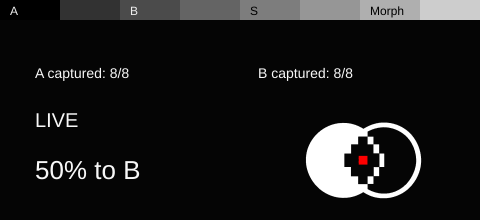
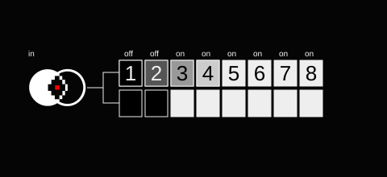
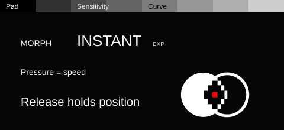

# Morph for OP-XY

**Morph v1.2.0** - pressure-pad update, pinned to hardware-tested **Gate39**.

Capture two sounds across your instrument tracks, move toward either one, and return to a stored starting point. Choose which tracks participate, use the instrument HUD for performance and snapshot editing, or drive the movement with recorded automation and the stock LFO.

## What it does

- A/B snapshots across eight instrument tracks, plus an independent S return point.
- AUX M2 routing: enable or exclude tracks while keeping capture available for all eight.
- Instrument HUD with track capture, snapshot editing, jumps, sweep and latch.
- Metadata-driven capture/morphing of supported synth SHIFT parameters, including continuous and stepped controls.
- One recordable AUX movement lane with stock erasure and saved snapshot/reference data.
- Stock M4 LFO routed to Morph movement, respecting manual LIVE/BYPASS.

## Pressure-pad controls

M3 K1 selects PITCH/MORPH. K2 adjusts speed (-90% to +100%, then INSTANT). K3 selects SQRT, LINEAR or EXP. Enable LIVE on M1; release the pad to hold position.

## Start here

Read the [illustrated quick reference](docs/Morph-Quick-Reference.pdf) for screens and button combinations.

The repository contains source and a macOS Python/Tk builder. It does **not** contain OP-XY firmware, personal projects, precompiled machine collections or a universal flashable image. Your resulting firmware depends on the existing collection and its matching source/layout provenance.

1. Follow [Building and installation](docs/BUILDING.md), including prerequisites and your own matching private kit.
2. Open `Open_Morph_Builder.command` (or `builder/Open_XY_Machine_Manager.command`), or run `python3.12 builder/app.py`.
3. Scan your OP-XY in **MTP file transfer (Mac)** mode. Choose your matching kit; earlier local build jobs can be recognized by the scanned OS hash.
4. Choose **Install bundled Morph**, or explicitly replace an installed Morph with this release. Calculate footprint, then build and review.
5. Stage only the verified candidate. The SDK backs up and reads back staged files; run **WRITE OS** on the XY and reboot to activate them.

The final build must reconstruct the original setup and fit the protected **4 MiB module reservation**. Unknown provenance, incompatible kits and over-capacity builds are refused. This region is not total storage or CPU usage. Scanning, calculation and building remain read-only toward the device; staging is separate and never writes the boot partition itself.

## MIDI movement

Use **MIDI channel 12, CC 15**, with Morph manually set LIVE.

| CC value | Movement |
|---|---|
| 0 | A endpoint |
| 63 or 64 | Current movement origin |
| 127 | B endpoint |

Origin is the existing movement reference; it is not necessarily S. MIDI does not reactivate BYPASS and is not recorded into the AUX automation lane. Physical K4 recording remains available. See [MIDI behaviour and takeover](docs/MIDI.md).

## Release status

Pinned to Gate39. The owner confirms no regressions and correct feature operation on hardware.

- AUX M3 K1: stock PITCH or MORPH pad mode.
- K2: speed -90% through +100%, then INSTANT; bounded intermediate steps.
- K3: SQRT / LINEAR / EXP pressure response.
- Release holds position; INSTANT requests full A/B from a directional push.
- Mode changes wait for release. Settings save with snapshots in the project companion.
- Held instrument HUD delay is 150 ms; exact-endpoint reversal fixed.
- MIDI channel 12 CC15, automation, routing, locks and existing controls retained.

Older snapshot formats load with compatible defaults. This release saves v5 banks; older releases reject them. Preserve original project/companion copies for rollback. v1.1.0 remains available unchanged.

The release contains source, macOS builder and an updated illustrated quick reference. Supply your own firmware and compatible private kit/provenance. No OS image, private kit or user projects included. Every native build must independently verify reconstruction and the protected 4 MiB allocation before staging. WRITE OS stays manual.

Host verification: 24,635 pad checks, 17,346 integration assertions, M1 and route parity pass. The inherited full SDK suite remains non-green (18 failures, 15 errors); logs included. Hardware acceptance is the owner's report, not independently measured here. CPU profiling remains unmeasured; upstream catalog approval is not claimed. Fresh acceptance of this exact public archive remains pending.

## Read more

- [Quick reference](docs/Morph-Quick-Reference.pdf) and [editable manual source](docs/Morph-Reference-Source.zip)
- [Building](docs/BUILDING.md), [known issues](docs/KNOWN_ISSUES.md), [validation](docs/VALIDATION.md)
- [Release notes](CHANGELOG.md), [version pin](release.json), [maintainer publishing steps](PUBLISHING.md)

## Source and license

`morphcapture/` is the machine source. `builder/` contains the current source builder, an identical machine copy and the patched SDK 1.15 fork based on [Open-XY](https://github.com/etcetc000/open-xy) commit `6642b3c6165043d29d4c9c9429294a42b71f924f`. Morph uses private SDK access hooks; importing it into an arbitrary unmodified upstream SDK is not supported.

The repository retains its **GPL-3.0** license. Vendored Open-XY SDK and legacy SDK components retain their **MIT** notices; see [third-party notices](NOTICE.md). Independent project; not affiliated with or endorsed by teenage engineering.
